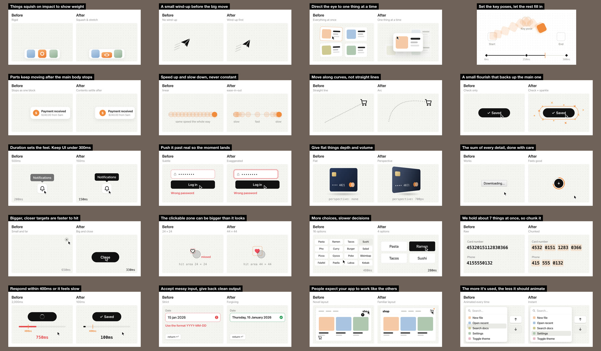

# charles-ux-animation



Makes your interface move and respond the way the best apps do: the 20 principles of UX and animation, as steps your
agent follows whenever it builds or reviews an interaction.

```bash
npx skills add LemonFace0309/charles-skills --skill charles-ux-animation
```

Add `-g` to install it for every project, or copy this folder into `~/.claude/skills/` (Claude Code) or
`~/.agents/skills/` (Codex).

## What it does

- Asks whether something should move at all, and where the eye should go
- Picks how it moves: easing, duration, arcs, follow-through
- Checks that people can find, hit and choose things, and get to the end of the task

It also carries Emil Kowalski's animation rules, Interface Craft's motion techniques and 13 more laws of UX.

## Try it

```text
/charles-ux-animation the add-to-cart flow
/charles-ux-animation review the motion in the onboarding screens
```

## Pairs with

[charles-polish](../../design/charles-polish/) for the details, frame by frame, and
[charles-unslop](../../design/charles-unslop/) if the screen still looks AI-made.

## Credits

1–12 are Disney's principles of animation from *The Illusion of Life* by Frank Thomas and Ollie Johnston. Most of the
list comes from Raphael Salaja's [userinterface.wiki](https://www.userinterface.wiki), and the laws go deeper on Jon
Yablonski's [Laws of UX](https://lawsofux.com). #20 and the animation rules and recipes are Emil Kowalski's
([animations.dev](https://animations.dev)), and the motion techniques come from Josh Puckett's
[Interface Craft](https://interfacecraft.dev).
